# 🌌 Hyprland dotfiles — «dark glass»

Робочий стіл на **Arch Linux + Hyprland (Lua-конфіг) + Quickshell** у стилі «темне скло»:
анімовані паралакс-шпалери з візуалізатором музики, 5 тем, що перефарбовують увесь інтерфейс,
бокова панель як у KDE, буфер обміну, екран блокування, OSD, меню пристроїв і ще купа всього.

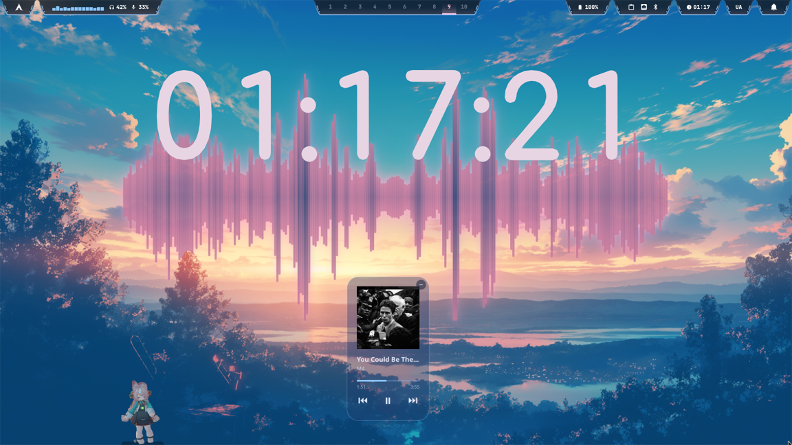

| Неон Сіті | Синтвейв |
|---|---|
| 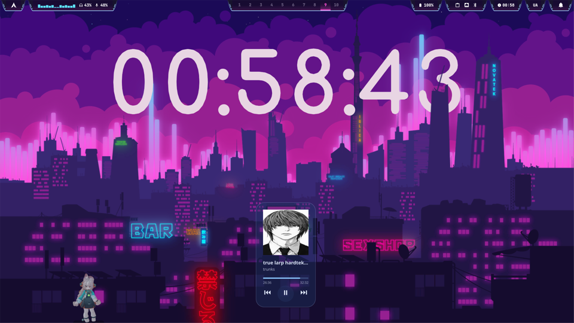 | 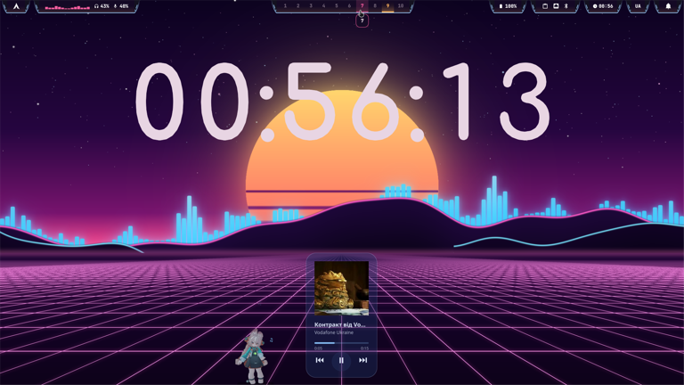 |
| **Північне сяйво** | **Зоряні гори** |
| 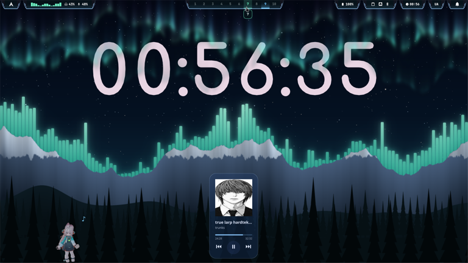 | 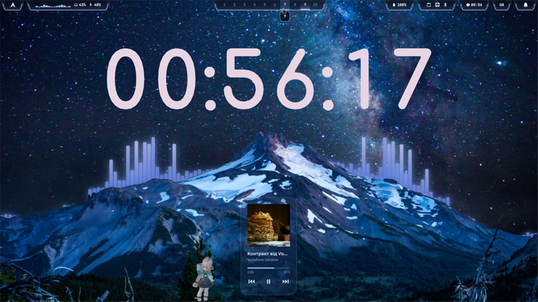 |

## Інтерфейс

| Бокова панель (Win) | Меню тем (Pause) |
|---|---|
| 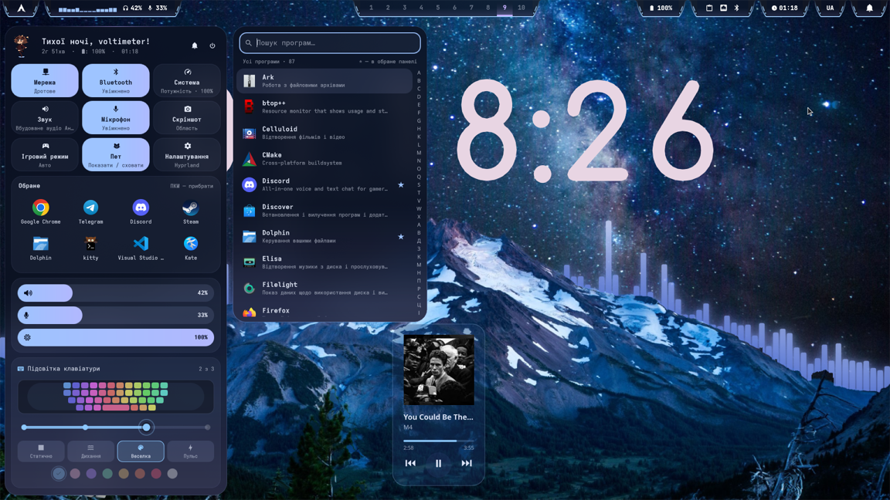 | 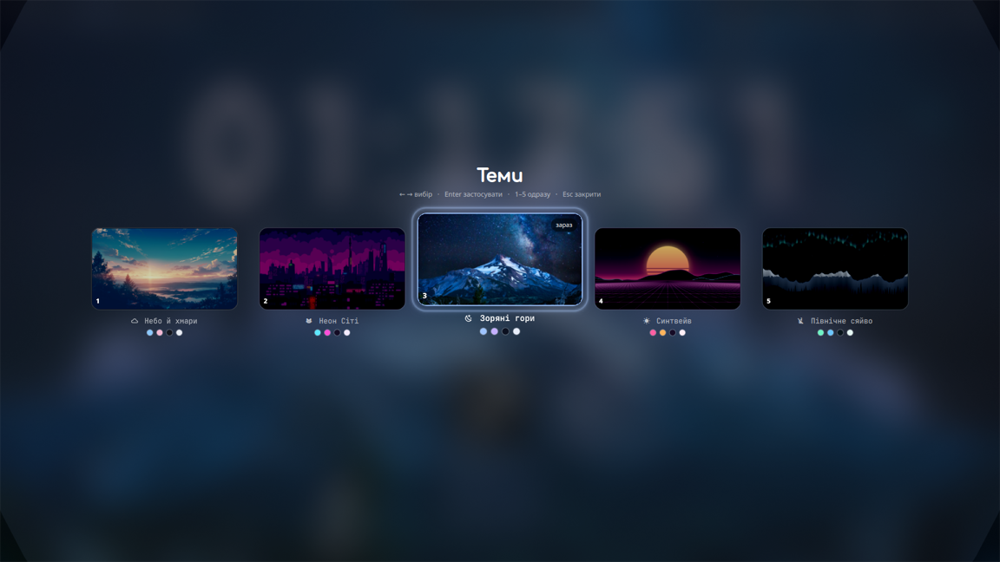 |
| **Налаштування (Win+I)** | **Буфер обміну (Win+V)** |
| 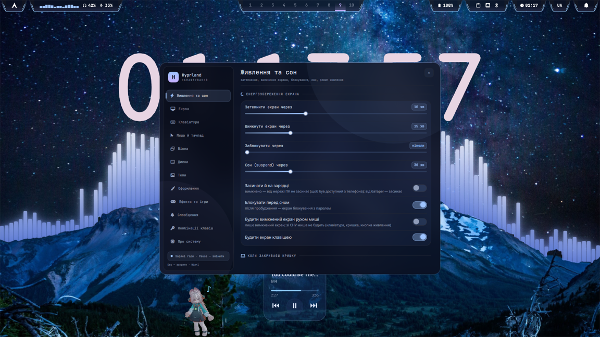 | 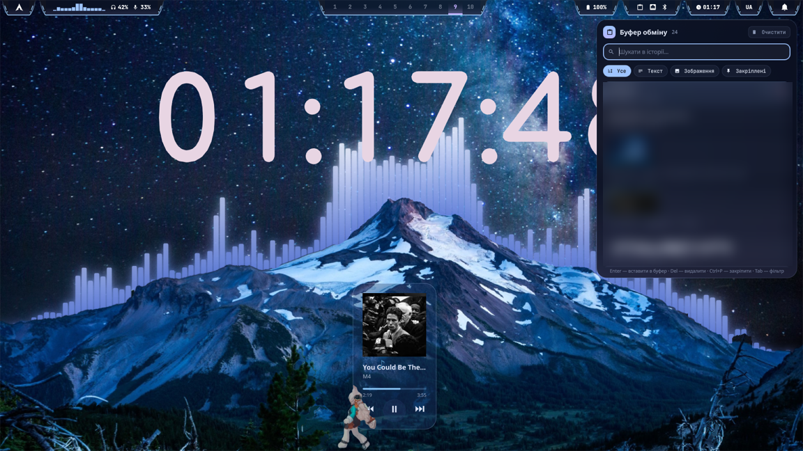 |
| **Система (waybar)** | **Мережа** |
| 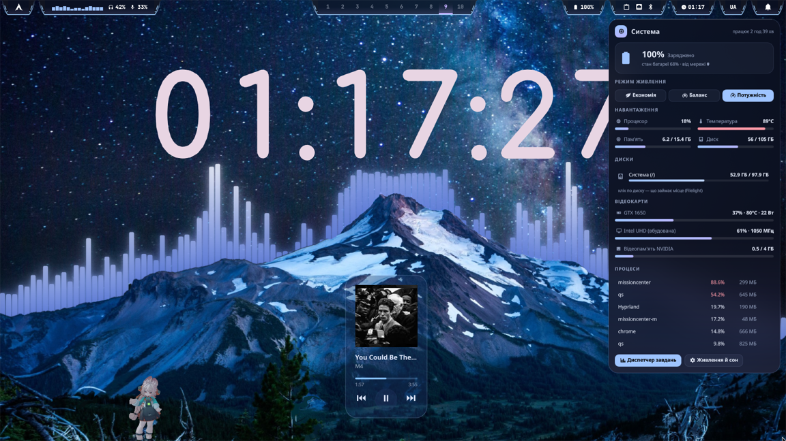 | 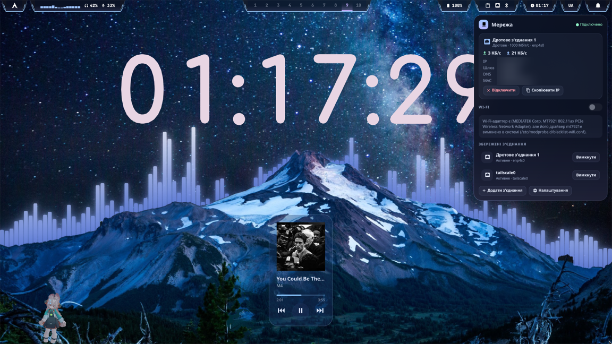 |
| **Bluetooth** | **Звук** |
| 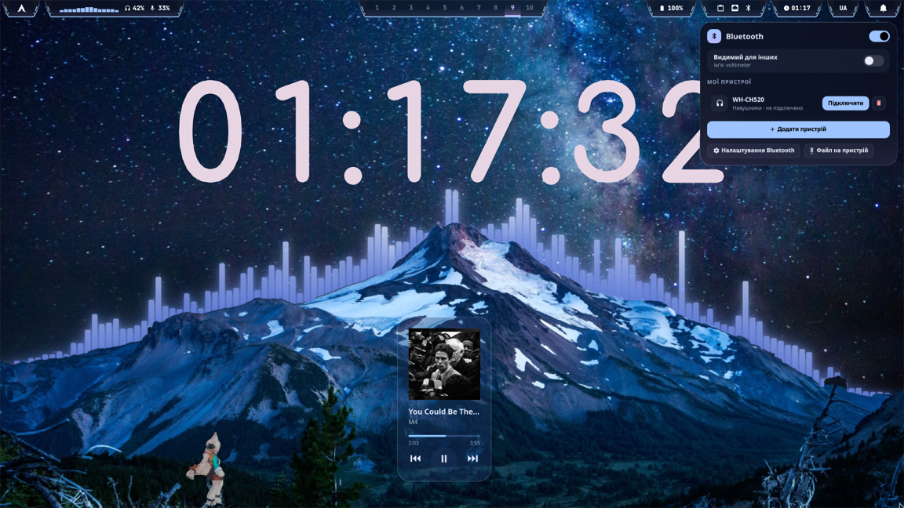 | 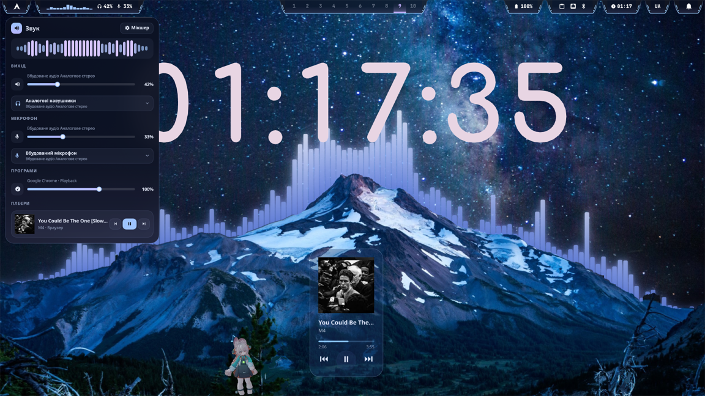 |
| **Календар** | **Флешки й пристрої** |
| 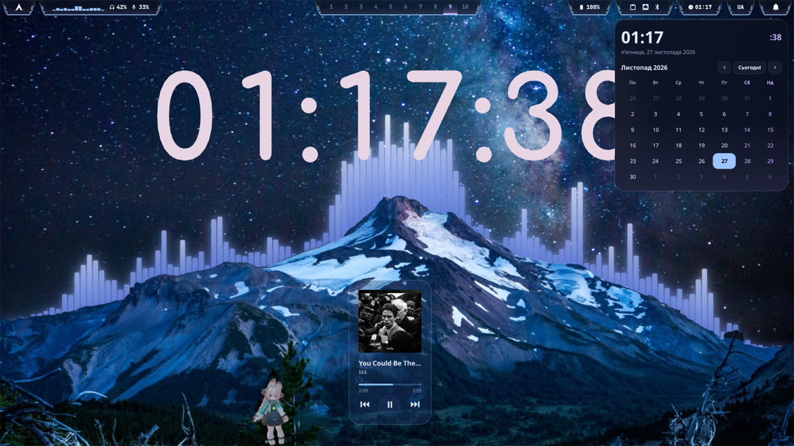 | 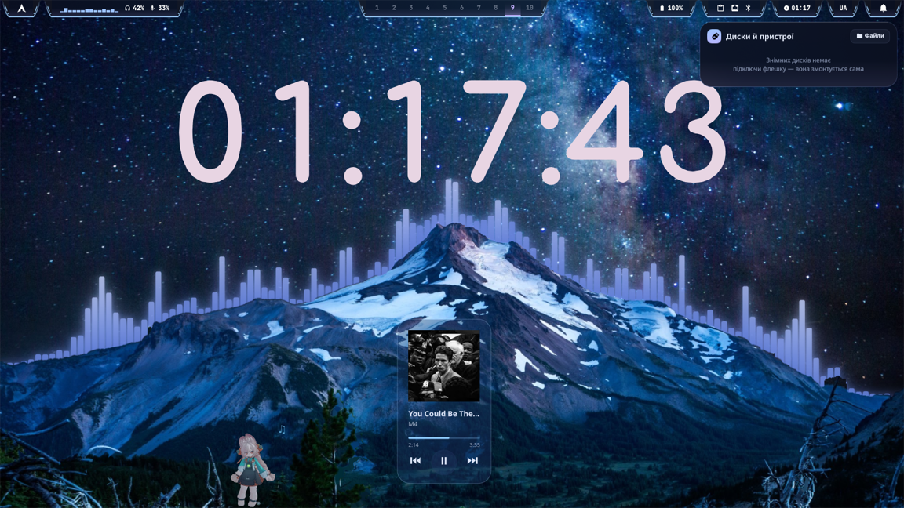 |
| **Меню живлення (Win+M)** | **OSD гучності** |
| 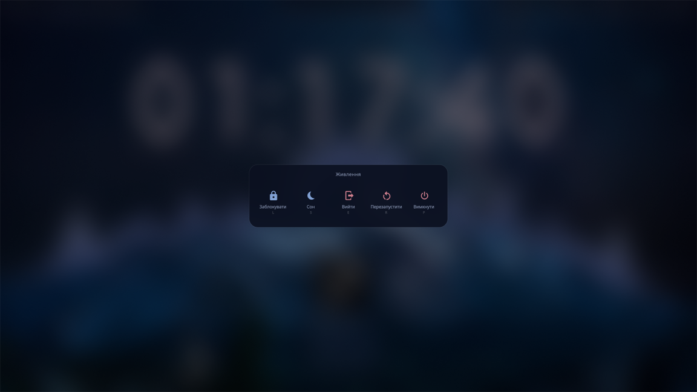 | 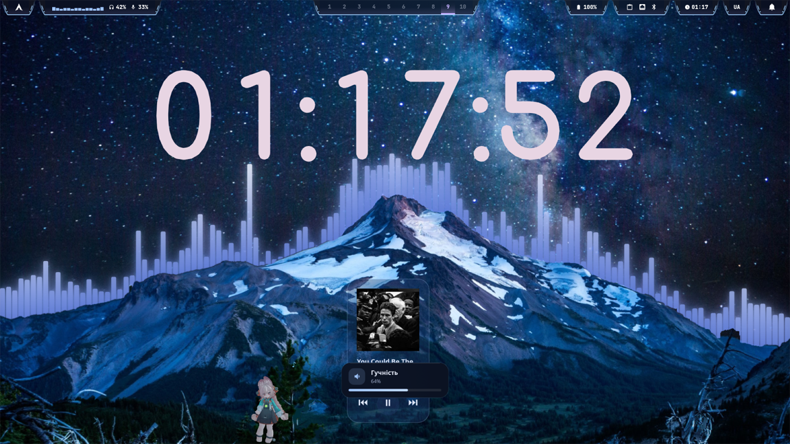 |

## Що всередині

| Тека | Що це |
|---|---|
| `.config/hypr` | Hyprland **0.57+ з Lua-конфігом** (`hyprland.lua`), hypridle, hyprpaper |
| `.config/wallpapers_QS` | Усі вікна на Quickshell: |
| ├ `bg_parallax_MDRG` | паралакс-шпалери + годинник, плеєр, візуалізатор (cava), що «виростає» з-за гір / будинків |
| ├ `bg_sidepanel` | бокова панель (натиснути й відпустити **Win**) |
| ├ `bg_popups` | вікна мережі / Bluetooth / системи / живлення з waybar |
| ├ `bg_clipboard` | історія буфера обміну з картинками (**Win+V**) |
| ├ `bg_themes` | меню тем з анімаціями (**Pause**) |
| ├ `bg_lock`, `bg_welcome`, `bg_osd` | екран блокування, заставка входу, OSD гучності / яскравості / флешок |
| ├ `bg_pet` | улюблениця на робочому столі (необов'язково, мозок — Ollama) |
| ├ `tools/` | бекенди: `theme`, `clipd`, `powerd` (економія, ліміт заряду), `devices` (флешки), `gamemode`, `osdctl`, `lock` |
| ├ `sddm-theme/glass` | тема екрана входу SDDM |
| └ `boot-splash/archglass` | заставка завантаження Plymouth |
| `.config/quickshell-settings` | вікно налаштувань (**Win+I**): теми, дисплеї, курсор, диски, батарея… |
| `.config/waybar` | верхня панель |
| `.config/kitty`, `.config/fish`, `.config/fastfetch` | термінал, оболонка, fetch |
| `.config/swaync`, `wofi`, `wlogout`, `cava`, `btop`, `mpv`, `gtk-3.0/4.0` | решта |
| `.local/share/icons/Glass`, `Minimal` | курсори |

## Встановлення

> Потрібен **Arch Linux** (або похідний) і **Hyprland ≥ 0.57** (з підтримкою `hyprland.lua`).

```bash
git clone https://github.com/Volod3/hyprland-dotfiles.git
cd hyprland-dotfiles
./install.sh
```

Скрипт:
1. ставить потрібні пакети через `pacman` (пропустити — `./install.sh --no-pkgs`);
2. **переносить твої старі конфіги** у `~/.config-backup-<дата>` і копіює нові;
3. підставляє твій `$HOME` і ім'я користувача в шляхи;
4. вмикає тему «Зоряні гори» і робить `fish` оболонкою.

Тему входу SDDM і заставку завантаження Plymouth ставить `./install.sh --extras` (потрібен `sudo`).

Потім вийди з сесії й обери **Hyprland**.

### Вручну (без скрипта)

```bash
cp -r .config/* ~/.config/
cp -r .local/* ~/.local/
grep -rIl /home/voltimeter ~/.config | xargs sed -i "s|/home/voltimeter|$HOME|g"
~/.config/wallpapers_QS/tools/theme set mountains
```

## Клавіші

| Клавіші | Дія |
|---|---|
| **Win** (натиснути й відпустити) | бокова панель |
| **Win+Q** | термінал (kitty) |
| **Win+C** | закрити вікно |
| **Win+Space** / **Win+R** | запуск програм (wofi) |
| **Win+D** | файли (Dolphin) |
| **Win+V** | буфер обміну |
| **Win+I** | налаштування |
| **Win+L** | заблокувати екран |
| **Win+M** / кнопка живлення | меню живлення |
| **Pause** | меню тем |
| **Win+F** / **F11** | на весь екран |
| **Win+Shift+F** | розгорнути |
| **Win+Shift+V** | плаваюче вікно |
| **Win+Alt+P** | псевдоплитка |
| **Win+1…0** / **Win+Shift+1…0** | робочий стіл / перенести вікно |
| **Win+A** / **Win+Shift+A** | прихований стіл / перенести туди |
| **Win+ЛКМ** / **Win+ПКМ** | перетягнути / змінити розмір |
| **Win+Shift+стрілки** | змінити розмір |
| **Print** | знімок екрана |
| **Shift+Print** / **Win+Shift+S** | знімок зони |

## Теми

5 тем: **Небо й хмари**, **Неон Сіті**, **Зоряні гори**, **Синтвейв**, **Північне сяйво**.
Тема міняє шпалери і кольори waybar, сповіщень, бокової панелі, вікон Quickshell, kitty та рамок вікон.

```bash
~/.config/wallpapers_QS/tools/theme list        # усі теми
~/.config/wallpapers_QS/tools/theme set neon    # застосувати
~/.config/wallpapers_QS/tools/theme next        # наступна
```

Теми описані в `~/.config/wallpapers_QS/themes/themes.json`.
Якщо міняєш шари шпалер, перерахуй лінію, з-за якої росте візуалізатор:
`python ~/.config/wallpapers_QS/tools/themes/ridge.py` (потрібні `python-numpy`, `python-pillow`).

## Під своє залізо

Конфіг писався під ноутбук ASUS TUF (Intel + NVIDIA GTX 1650, 1920×1080@144). Що варто перевірити:

- `~/.config/hypr/hyprland.lua`: `hl.monitor` на початку (назва і частота твого екрана) і `kb_layout` (розкладки, за замовчуванням us, ua);
- `~/.config/hypr/gpu-env.lua`: змінні для гібридної графіки, генерує `tools/powerd` (Win+I → Живлення → Відеокарта);
- `~/.config/hypr/user-settings.lua`: NumLock та інше, що міняється через **Win+I**;
- **ліміт заряду батареї** (80 %) і підсвітка клавіатури працюють там, де ядро їх підтримує;
- `tools/remote-desktop` (VNC через Tailscale) і `claude-phone.service` — особисті штуки, можна не вмикати;
- улюблениці потрібен [Ollama](https://ollama.com) з будь-якою невеликою моделлю, інакше вона просто гуляє екраном.

## Не працює?

```bash
qs log -p ~/.config/wallpapers_QS/bg_parallax_MDRG/shell.qml   # помилки шпалер (так само для інших bg_*)
hyprctl configerrors                                            # помилки конфіга Hyprland
```
